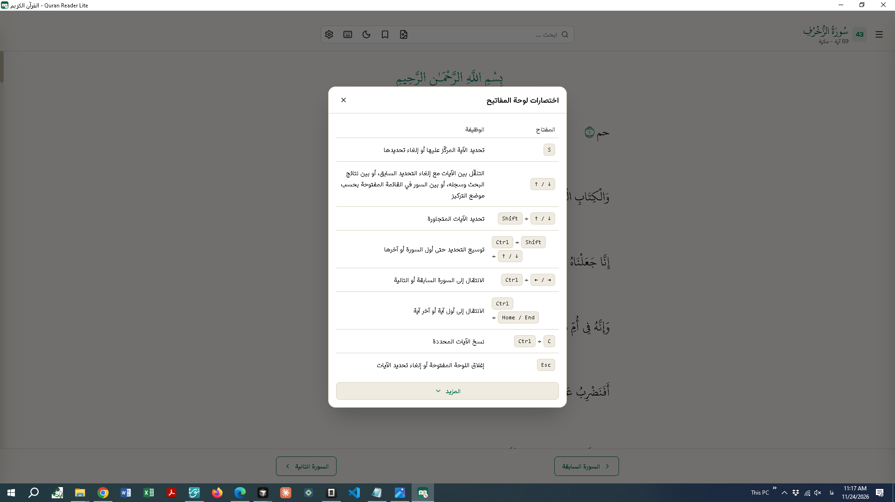
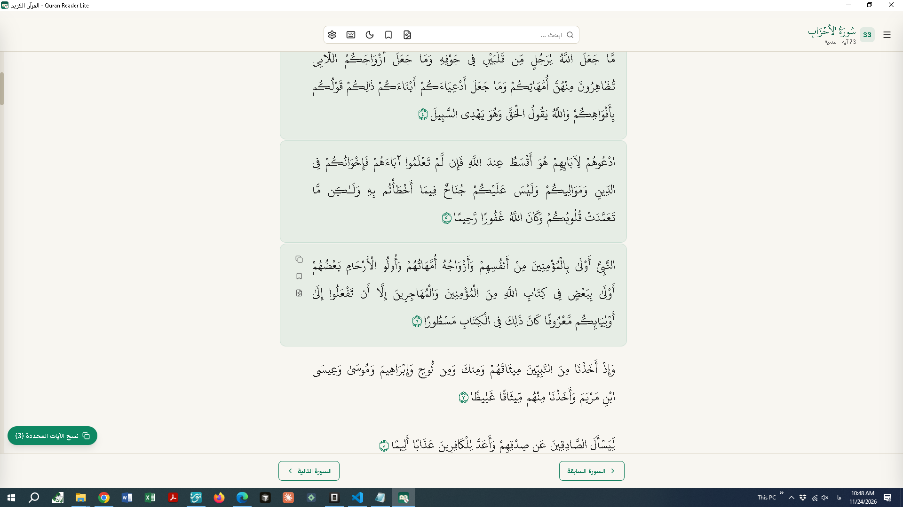
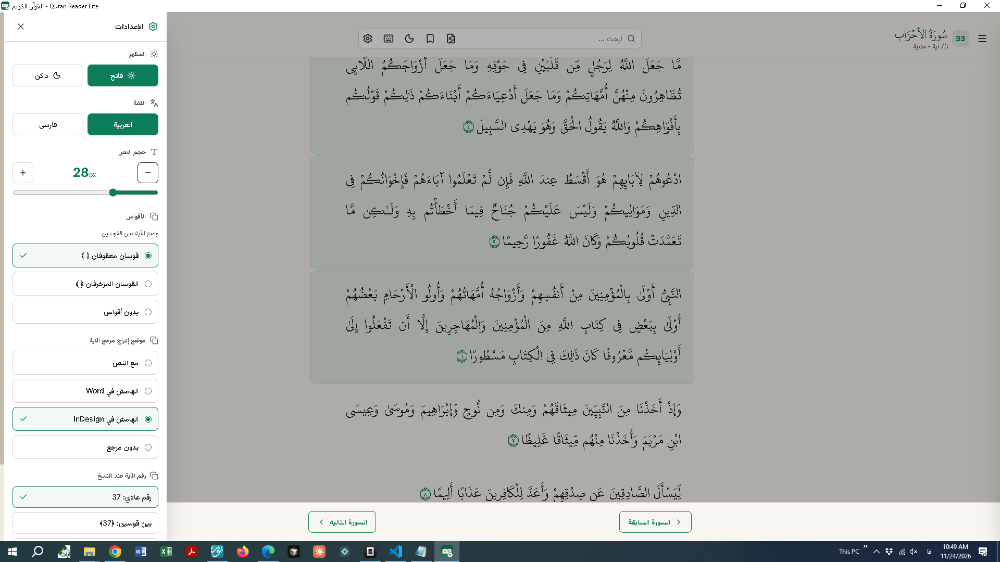
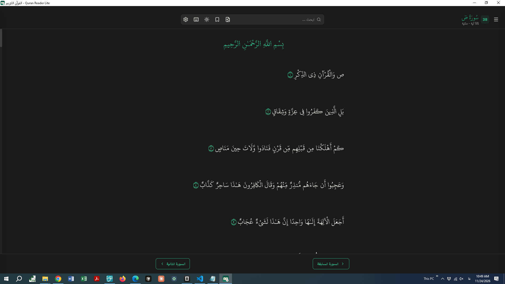
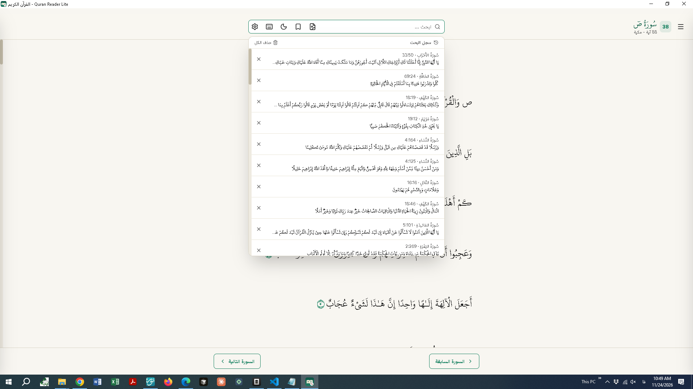
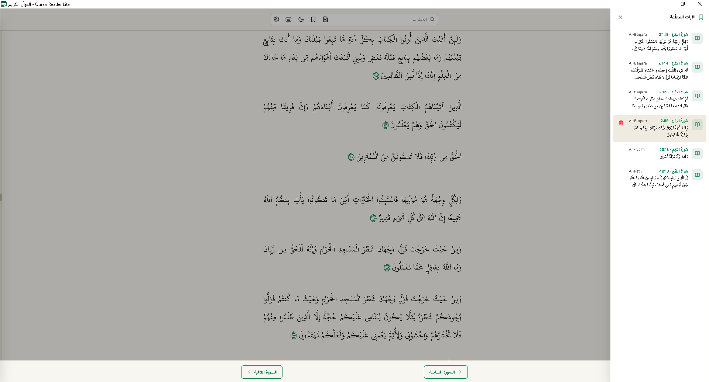
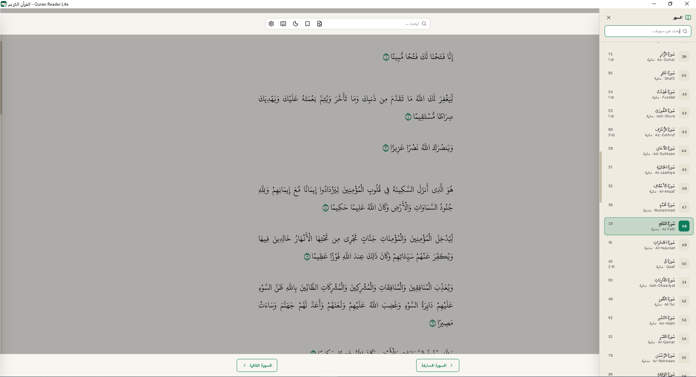
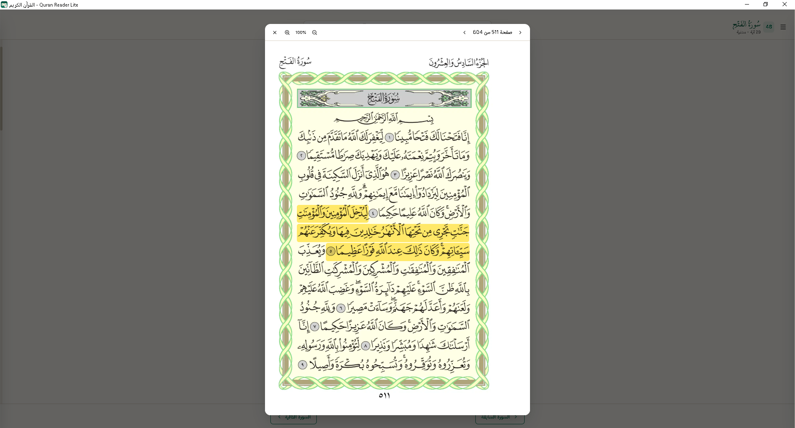
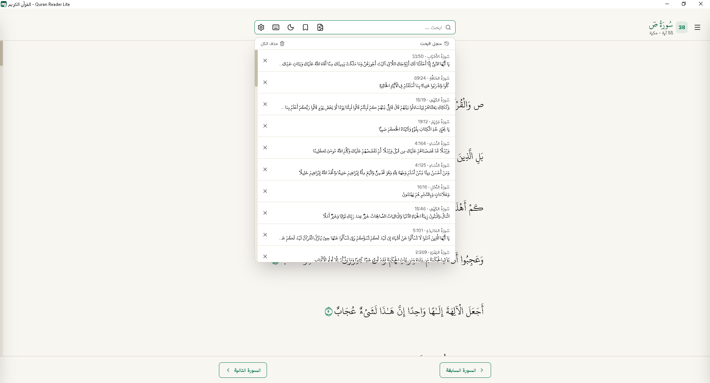

# 📖 Quran Reader Lite — macOS

<p align="center">
  
</p>

**Quran Reader Lite** is a fast, offline-first Quran reader for macOS. It keeps the complete Arabic text of the Quran and deliberately leaves out translation and tafsir collections, so the app stays light, quick to start, and completely independent of a network connection.

> 🍎 This repository contains the **macOS** edition only. It builds a universal app for Apple Silicon and Intel Macs.

<p align="center">
  🌐 Language: <strong>English</strong> · <a href="README-AR.md">العربية</a>
</p>

---

## ⬇️ Download

Click a link below and the download starts immediately — no GitHub page and no sign-in.

| 🍎 macOS v1.0.0 (universal · Apple Silicon + Intel) | 🪟 Windows v1.0.4 |
|:---:|:---:|
| [📥 Download DMG](https://github.com/mediadesign853-cpu/quran-lite-macos/releases/download/v1.0.0/Quran.Reader.Lite-1.0.0-universal.dmg) | [📥 Download Setup](https://github.com/mediadesign853-cpu/Quran-Lite/releases/download/v1.0.4/Quran-Reader-Lite-Setup-1.0.4.exe) |
| [📥 Download ZIP](https://github.com/mediadesign853-cpu/quran-lite-macos/releases/download/v1.0.0/Quran.Reader.Lite-1.0.0-universal.zip) | [📥 Download Portable](https://github.com/mediadesign853-cpu/Quran-Lite/releases/download/v1.0.4/Quran-Reader-Lite-Portable-1.0.4.exe) |

---

## 📸 Screenshots

Click any image to open it at full size.

<p align="center">
  <a href="docs/screenshots/screenshot-1.png"></a>
  <a href="docs/screenshots/screenshot-2.png"></a>
</p>

<p align="center">
  <a href="docs/screenshots/screenshot-3.png"></a>
  <a href="docs/screenshots/screenshot-4.png"></a>
</p>

<p align="center">
  <a href="docs/screenshots/screenshot-5.png"></a>
</p>
<p align="center">
  <a href="docs/screenshots/screenshot-6.png"></a>
</p>
<p align="center">
  <a href="docs/screenshots/screenshot-7.png"></a>
</p>
<p align="center">
  <a href="docs/screenshots/screenshot-8.png"></a>
</p>
<p align="center">
  <a href="docs/screenshots/screenshot-9.png"></a>
</p>

---

## ✨ Features at a glance

### 📖 Reading the Quran
- Complete Arabic text: **114 surahs / 6,236 ayahs**, with the Uthmani script preserved exactly as in the source data.
- Surah browser with verse counts and revelation type (Makki / Madani).
- Light and dark themes, adjustable Arabic font size, and Persian or Arabic interface language.
- Remembers the last reading position and resumes automatically.

### 🔎 Search
- Instant search across surah names **and** ayah text using a prebuilt search index.
- Results jump directly to the matching ayah, with keyboard navigation through the result list.
- `Ctrl/Cmd + F` focuses the search box from anywhere in the app.

### 🔖 Bookmarks and history
- Bookmark a single ayah or a multi-ayah selection; toggle a bookmark with the `B` key.
- Bookmarks panel lists everything you saved and closes with `Esc`.
- Reading history and "last read" are stored locally.

### 📋 Copying ayahs
- Copy plain ayah text, text with the reference inline, or text without the reference.
- Configure the ayah-number style (`plain`, `brackets`, `none`) and bracket style (`curly`, `ornate`, `none`).
- Optional modes prepare text for a **real Word or InDesign footnote** instead of a plain-text reference.
- Select several consecutive ayahs with the keyboard or mouse and copy them together.

### 🖼️ Mushaf page images
<p align="center">
  
</p>

- All **604 pages** of the Madinah Mushaf are shipped inside the application.
- When you open a page for an ayah, its exact position is highlighted in yellow for three seconds (`M` key or the reader action).
- Page zoom from 50% to 300%, previous/next page buttons, and arrow-key navigation.
- Highlighted ayah can be replayed on demand.

### ⌨️ Keyboard shortcuts
| Shortcut | Action |
|---|---|
| `S` | Select / deselect the focused ayah |
| `↑ / ↓` | Move between ayahs, search results, or surahs depending on focus |
| `Shift + ↑ / ↓` | Select adjacent ayahs |
| `Ctrl + Shift + ↑ / ↓` | Extend selection to the start or end of the surah |
| `Ctrl + ← / →` | Previous / next surah |
| `Ctrl + Home / End` | First / last ayah |
| `Ctrl + C` | Copy selected ayahs |
| `Esc` | Close an open panel or clear the selection |
| `Ctrl/Cmd + F` | Focus search |
| `Alt + S` | Toggle the surah list |
| `Alt + B` | Toggle bookmarks |
| `Ctrl/Cmd + ,` | Toggle settings |
| `Alt + T` | Toggle light / dark theme |
| `Alt + H` | Open the shortcut help dialog |
| `B` | Add / remove the focused ayah from bookmarks |
| `M` | Open the Mushaf page of the focused ayah |
| `← / →` | Navigate Mushaf pages when the page viewer is open |

### 🍎 Real footnotes in Word and InDesign (macOS)
- Inserts the Arabic ayah into the active document and places its reference in a **native footnote**.
- If the target footnote already exists, its text is updated inside that footnote instead of creating a new one.
- Uses Apple Events / JXA; no Word or InDesign plug-in is required.
- Requests macOS Automation permission on first use and explains failures with a short in-app message.
- Refuses to guess when several InDesign instances are open, so text never lands in the wrong document.

### 📴 Offline by design
- The desktop app reads its files from the application bundle; it never needs a server.
- The production web build registers a service worker that precaches the app shell, all surah data, the search index, fonts, and icons.
- Preferences, bookmarks, and reading history stay in local storage on your machine.

### 🔒 Security and privacy
- No accounts, no telemetry, no remote content, no text uploads.
- Electron renderer runs with `sandbox: true`, no Node integration, and context isolation.
- Only the internal `app://quran` and `qpage://pages` protocols are accepted; navigation to external pages is blocked and external links open in the default browser.
- Permissions are limited to sanitized clipboard writes from the trusted main frame.
- Single-instance lock prevents two copies from writing the same local data.

### 🚀 Performance and integrity
- Cold start of the interface and core data is targeted at **under three seconds**.
- `npm run check` verifies 114 surahs, 6,236 ayahs, 604 page images, and the ayah-box metadata before every build.
- Dependency tree is current, `npm audit` reports **0 vulnerabilities**, and the known minimatch problem is pinned to `11.0.9`.

---

## 🧰 Requirements

| Tool | Version |
|---|---|
| macOS | Any recent version; the build produces a **universal** DMG/ZIP (Apple Silicon + Intel) |
| Node.js | **22.13.0** or newer |
| npm | **10** or newer |
| Xcode Command Line Tools | Needed for native Electron/macOS packaging |

Install the Apple command-line tools if they are not present:

```bash
xcode-select --install
```

---

## 🚀 Getting started

### 1. Install dependencies

```bash
npm ci
```

### 2. Run the full verification suite

```bash
npm run check
```

This runs, in order: data verification → Electron security tests → TypeScript check → ESLint → production web build.

### 3. Choose how to run it

**Web application (Vite dev server):**

```bash
npm run dev
```

Open <http://localhost:5173>. Use this for UI work. Real Word/InDesign footnotes require the desktop shell.

**Desktop application (development):**

```bash
npm run electron:dev
```

This builds the web app, prepares `electron/dist`, and launches Electron.

**Production web build:**

```bash
npm run build
npm run preview
```

The service worker is registered only for `http(s)` production builds, not in development and not inside the desktop shell.

**macOS installers (must run on a Mac):**

```bash
npm ci
npm run check
npm run dist:mac
```

Outputs appear in `release/`:

```text
Quran Reader Lite-1.0.0-universal.dmg
Quran Reader Lite-1.0.0-universal.zip
```

The GitHub Actions workflow `.github/workflows/build-macos.yml` performs the same build on a macOS runner and uploads the DMG and ZIP to the GitHub release automatically.

---

## 🍎 Using Word / InDesign footnotes

1. Open Microsoft Word or Adobe InDesign with a document already open. The bridge intentionally does **not** launch a new target application.
2. **Word:** place the cursor where the ayah should go. If text is selected, it is replaced by the ayah and the reference becomes a real Word footnote; otherwise the ayah is inserted at the cursor.
3. **InDesign:** choose the Type tool and click inside a text frame until a text cursor is visible. Selecting the frame itself is not enough; a text cursor or a text selection inside a story is required.
4. On first use macOS may ask for permission to control Word or InDesign. Choose **Allow**. Permissions can be managed in `System Settings → Privacy & Security → Automation`.
5. If more than one InDesign instance is running, the operation stops so it cannot insert into the wrong copy. Keep only the instance with the target document open.

Word uses its own AppleScript dictionary to create the footnote. InDesign runs the bundled ExtendScript in the already-running instance via `do script`. Neither application needs an add-on.

If insertion fails, the app shows a short message and copies the ayah with its reference as a fallback. Detailed diagnostics are written to:

```text
logs/footnote-integration.log
```

inside the Electron `userData` directory (normally `~/Library/Application Support/Quran Reader Lite/` for installed builds, and a development-named folder for `electron:dev`).

---

## 🗂️ Project layout

| Path | Purpose |
|---|---|
| `src/` | React + TypeScript user interface |
| `public/data/` | Surah metadata, per-surah ayah data, and the search index |
| `public/icons/`, `manifest.json` | PWA icons and manifest |
| `electron/` | Desktop shell, preload bridge, security modules, and the Apple Events footnote bridge |
| `electron/pages/` | The 604 Mushaf page images and `boxes.json` highlight rectangles |
| `scripts/` | Data verification, Electron packaging, release build, and security tests |
| `.github/workflows/` | macOS release build and asset upload |

Quran data files, page images, and the Mushaf box metadata are treated as immutable assets and are verified byte-for-byte before release.

---

## ✅ Release

Current release: **[v1.0.0](https://github.com/mediadesign853-cpu/quran-lite-macos/releases/tag/v1.0.0)**.

The release page is the place to download the universal DMG/ZIP once the macOS build workflow finishes.

---

## 📄 Attribution

Quran text data is derived from the Tanzil Project and distributed under **CC BY 3.0**. Fonts and third-party packages keep their own licenses; see `NOTICE.txt` in the repository.

<p align="center"><em>Made for quiet, focused recitation — online or off.</em> 🌙</p>
